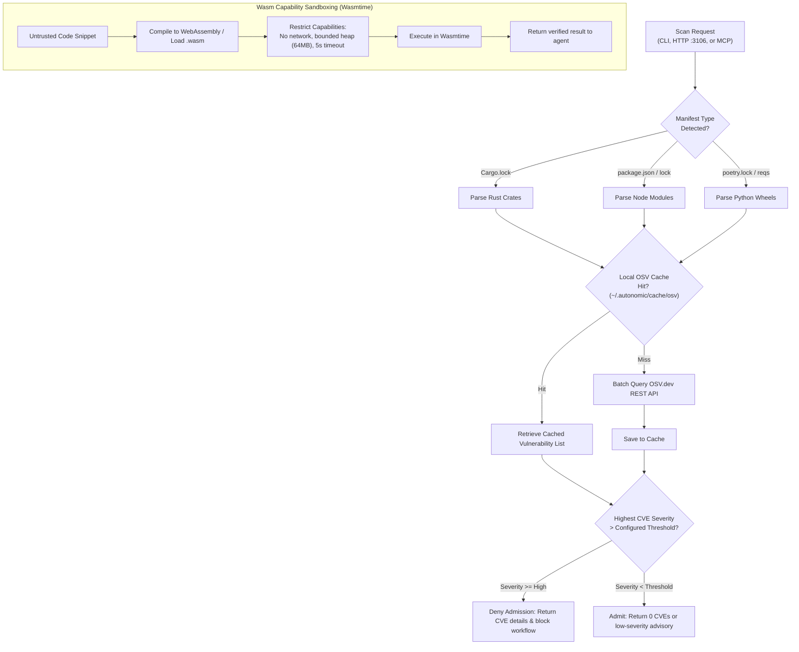

# agent-immune — Deep Operational & Architectural Context for Agents

> **Admission Controller, OSV Vulnerability Scanner & Sandboxing Policy** — In-depth architectural guide, CVE audit engine, Wasm micro-sandboxing, CLI matrix, HTTP/MCP contracts, and failure recovery runbooks for `agent-immune`.  
> **Ecosystem Version Baseline:** `v1.0.0-beta.3`  
> **Documentation Hub:** [https://autonomic-ai.dev/docs/security](https://autonomic-ai.dev/docs/security) · [Architecture Hub](https://autonomic-ai.dev/docs/architecture)  
> **Port:** HTTP API `:3106`  
> **Default Workspace & Cache:** `~/.autonomic/immune/` · `~/.autonomic/cache/osv/`

---

## 1. Executive Summary & Biological Role

In the Autonomic 11-organ architecture, **`agent-immune`** serves as the **Zero-Trust Security Gatekeeper, Admission Controller, and Vulnerability Auditor** (analogous to Kubernetes Admission Controllers, OPA Gatekeeper, and container vulnerability scanners like Trivy).

When autonomous agents install third-party dependencies or execute untrusted generated scripts, traditional environments face severe attack vectors:
1. **Supply Chain Attacks & Malicious Packages:** Agents can blindly install typo-squatted or compromised packages from npm, PyPI, or crates.io containing backdoors.
2. **Escaping Host Isolation:** Untrusted code executed on the host can access user environment variables, SSH keys, or cloud credentials.
3. **Memory Leaks & Denial of Service:** Flawed agent loops can consume unbounded RAM, triggering system-wide OOM panics.

`agent-immune` provides active biological defense:
- **Pre-Execution Vulnerability Auditing:** Integrates directly with the Open Source Vulnerability (OSV) database to scan lockfiles (`Cargo.lock`, `package.json`, `poetry.lock`) before packages are loaded.
- **Wasm Capability Sandboxing:** Executes untrusted code inside capability-isolated WebAssembly (Wasmtime) sandboxes with zero host filesystem access unless explicitly granted.
- **Runtime Leak Detection:** Monitors process RSS growth to detect anomalous memory consumption across agent iterations.

---

## 2. Core Architecture & Security Pipeline



### 2.1 OSV Database Integration & Smart Caching
`agent-immune` batches dependency queries against the global OSV database (`https://api.osv.dev/v1/querybatch`):
- **Deterministic Checksums:** Identifies package versions and hashes, querying thousands of vulnerabilities in sub-second response times.
- **Local SQLite / JSON Cache:** Persists query responses in `~/.autonomic/cache/osv/` to allow offline CI runs and prevent upstream rate-limiting.
- **Severity Classification:** Categorizes CVEs according to CVSS scores (`LOW`, `MEDIUM`, `HIGH`, `CRITICAL`), enabling configurable blocking thresholds.

### 2.2 Dual-Layer Isolation & Micro-Sandboxing
- **Wasm Micro-Sandboxes:** For data transformation or untrusted script evaluation, `agent-immune` uses Wasmtime to create ephemeral instances with strict memory bounds (default 64MB) and hard instruction count limits.
- **Seccomp Syscall Filtering:** When running native subprocesses on Linux, it compiles BPF filters that drop dangerous syscalls (`ptrace`, `sys_chroot`, `mount`, `unshare`).

---

## 3. Complete CLI Command Reference & Flags

`agent-immune` provides a single native binary for daemon service, dependency scanning, and sandboxed execution:

### 3.1 Vulnerability Scanning Commands
- `agent-immune scan <PATH>`: Audit a directory, repository root, or specific package manifest for vulnerabilities.
  - `--severity <THRESHOLD>`: Exit with failure code only if vulnerabilities match or exceed severity (`low`, `medium`, `high`, `critical`; default: `high`).
  - `--cache-dir <DIR>`: Custom OSV cache directory (default: `~/.autonomic/cache/osv/`).
  - `--json`: Output detailed JSON payload with CVE IDs, CVSS scores, affected version ranges, and fixed versions.
  - `--offline`: Use only locally cached vulnerability data without querying upstream APIs.

### 3.2 Daemon & HTTP Service
- `agent-immune serve`: Start the HTTP REST API server and NATS JetStream event bridge.
  - `--port <PORT>`: HTTP API listening port (default: `3106`).
  - `--nats-url <URL>`: NATS broker URL (default: `nats://127.0.0.1:4222`).
  - `--deny-severity <THRESHOLD>`: Default severity threshold for automated admission blocking.

### 3.3 Sandboxed Execution
- `agent-immune sandbox run --wasm <FILE.wasm>`: Execute a pre-compiled WebAssembly module in an isolated runtime.
  - `--max-memory-mb <MB>`: Maximum allowable heap allocation (default: `64`).
  - `--timeout-secs <SECS>`: Execution timeout limit (default: `5`).
  - `--allow-dir <PATH>`: Mount a specific host directory as read-only inside the Wasm guest.

### 3.4 Leak Profiling & Diagnostics
- `agent-immune leak-check --pid <PID>`: Inspect memory growth anomalies of an active process over time.
- `agent-immune doctor`: Verify network access to OSV API, check Wasmtime engine initialization, and test cache file permissions.

---

## 4. HTTP & Model Context Protocol (MCP) Contracts

### 4.1 HTTP REST Endpoints (`:3106`)

#### `POST /scan`
Audit a manifest file payload for known CVEs.
Request:
```json
{
  "manifest_type": "cargo_lock",
  "content": "[[package]]\nname = \"vulnerable-crate\"\nversion = \"0.1.0\"..."
}
```
Response (`200 OK` - Clean):
```json
{
  "vulnerabilities_found": 0,
  "highest_severity": "NONE",
  "advisories": []
}
```
Response (`200 OK` - Vulnerabilities Detected):
```json
{
  "vulnerabilities_found": 1,
  "highest_severity": "HIGH",
  "advisories": [
    {
      "id": "RUSTSEC-2024-0012",
      "package": "vulnerable-crate",
      "installed_version": "0.1.0",
      "fixed_version": "0.1.4",
      "severity": "HIGH",
      "summary": "Out-of-bounds memory read in parser"
    }
  ]
}
```

#### `GET /health`
Returns health probe status, cache statistics, and engine readiness.

---

### 4.2 MCP Tools (via `agent-body serve-mcp` or stdio)

#### `immune_scan_manifest`
- **Description:** Scans a package lockfile (`Cargo.lock`, `package.json`, `poetry.lock`) for known vulnerabilities and CVEs.
- **Parameters:**
  - `path` (string, required): Absolute or workspace-relative path to the manifest file.
  - `min_severity` (string, optional, default `"high"`): Minimum severity threshold to report (`"low"`, `"medium"`, `"high"`, `"critical"`).
- **Return Object:**
  - `clean`: Boolean flag indicating if no vulnerabilities meet or exceed the threshold.
  - `vulnerabilities_count`: Number of vulnerabilities found.
  - `advisories`: Array of CVE details with recommended upgrade versions.

#### `immune_sandbox_run`
- **Description:** Runs an untrusted code snippet inside an isolated Wasm micro-sandbox.
- **Parameters:**
  - `wasm_bytes` (string, required): Base64-encoded WebAssembly binary.
  - `timeout_secs` (integer, optional): Maximum runtime before termination.

#### `immune_lint_ast`
- **Description:** Inspects source code syntax trees for banned patterns or security violations before execution.

---

## 5. Troubleshooting & Recovery Runbook

### 5.1 Problem: `agent-immune scan` Fails Due to Network / API Rate Limits
- **Cause:** Upstream OSV REST API is rate-limiting or experiencing transient downtime.
- **Resolution:**
  - Run scan in offline mode using cached data:
    ```bash
    agent-immune scan Cargo.lock --offline
    ```
  - Verify cache status: `ls -la ~/.autonomic/cache/osv/`.

### 5.2 Problem: Build Pipeline Blocked by False-Positive Vulnerability
- **Cause:** A development dependency triggered a high-severity alert that does not affect production code.
- **Resolution:**
  - Add an exclusion entry to `~/.autonomic/config.toml`:
    ```toml
    [immune]
    ignore_advisories = ["RUSTSEC-2023-0071"]
    ```
  - Re-run scan to confirm bypass.
